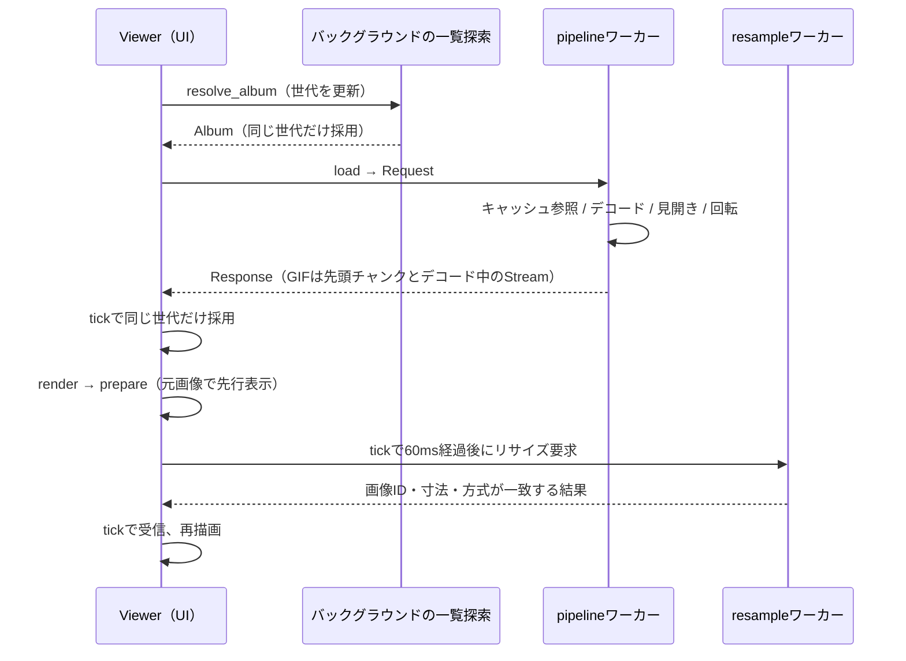

# コード構成と設計

開発を始めるときは [開発・検証](development.md)、操作と対応範囲は [README](../README.md) を参照する。この文書は現在の実装の責務と、変更時に維持する契約を説明する。

## モジュールの責務

通常バイナリは `src/main.rs` をルートとする。ライブラリクレートはなく、UI用の別ファイルも同じ `Viewer` に `impl Viewer` を追加する構成になっている。

| ファイル | 主な型・入口 | 責務 |
|---|---|---|
| [main.rs](../src/main.rs) | `Viewer`, `Command`, `main` | 起動、状態の所有、入力の振り分け、非同期結果の反映、描画、GPU画像の退役 |
| [i18n.rs](../src/i18n.rs) | `tr!`, 共有ローダー | Fluentの翻訳リソース、動的メッセージの引数、英語フォールバック |
| [model.rs](../src/model.rs) | `Album`, `Entry`, `Viewport`, `supported` | 画像とPDFのページの一覧、並び替え、フォルダとPDFの探索、倍率・パン計算 |
| [pdf/](../src/pdf/mod.rs) | `open`, `render`, `trim`, `Mode`, `Failure`, `helper_main` | PDFの補助プロセス（PDFiumのロード・分類と基準解像度・描画）、本体側の仲介スレッド（優先順位・時間制限・再起動）、記述子付きの通信 |
| [decoder.rs](../src/decoder.rs) | `Decoded`, `decode_limited`, `GifFrames`, `dimensions` | 形式判定、向き、GIFのフレーム列、libheif、表示画素への変換 |
| [pipeline.rs](../src/pipeline.rs) | `Loader`, `Request`, `Response`, `Loaded`, `PdfPage`, `Motion`, `worker` | デコード用ワーカー、世代管理、予算連動のLRU、GIFの逐次デコードの開始、PDFのページの描画要求、先読み、見開き合成（PDFの倍率合わせ）・回転 |
| [animation.rs](../src/animation.rs) | `Stream`, `Player`, `Chunk`, `Clip` | GIFの逐次デコードスレッド、チャンク化、全フレーム保持と逐次デコードの切り替え、再生の時刻管理 |
| [memory.rs](../src/memory.rs) | `Budget`, `Ledger`, `current`, `start_monitor` | メモリー予算、画素データの台帳、メモリー逼迫の検知、glibcの返却設定 |
| [resample.rs](../src/resample.rs) | `Algorithm`, `State`, `Vector` | 表示専用リサイズのワーカー（文字・図形を含むPDFのページは拡大時に描き直す）、要求の集約、古い結果の破棄 |
| [settings.rs](../src/settings.rs) | `Settings`, `BoundaryAction`, `SortOrder` | 設定値、既定値、正規化、JSONの読み書き |
| [window_state.rs](../src/window_state.rs) | `WindowState`, `restore_position` | 通常サイズ・位置・最大化の保存、画面変更時の補正、X11の位置復元 |
| [settings_ui.rs](../src/settings_ui.rs) | `Tab`, `Field`, `Selector` | 設定の下書き編集、候補一覧、キー割り当ての入力 |
| [bindings.rs](../src/bindings.rs) | `Shortcut`, `defaults` | 割り当て可能な操作と初期キー |
| [menu_ui.rs](../src/menu_ui.rs) | `Menu` | メニューバー、右クリックメニュー、メニュー内のキー操作 |
| [scrollbar.rs](../src/scrollbar.rs) | `settings_scrollbar` | 設定一覧のスクロールバーとドラッグ計算 |
| [viewer_io.rs](../src/viewer_io.rs) | `save_as`, `copy_image`, `show_information` | ファイル選択、書き出し、画像コピー、情報画面 |
| [ui_smoke.rs](../src/ui_smoke.rs) | `start` | `ui-smoke` feature専用の実ウィンドウ回帰テスト |
| [decode-bench.rs](../src/bin/decode-bench.rs) | `main` | GUIを起動せず、共有のdecoderでヘッダー取得とデコードを計測 |

## 開く操作から表示まで

`Viewer::new` は設定を読み、デコード用とリサイズ用のワーカーを用意する。約8msごとのtickerが `Viewer::tick` を呼び、結果の受信と自動送りを行う。UI状態は `Viewer` が所有し、ワーカーはGPUIのWindowを操作しない。

`open` はファイル／フォルダの指定を `resolve_album` へ渡す。ディレクトリ列挙とソートはバックグラウンドで行い、完了時に世代を照合する。採用した `Album` から `load` が現在ページ、回転、見開き候補、先読み候補を送る。空の一覧では画像を消し、進行中の要求を無効にする。

`pipeline::worker` は単一スレッドで、待っている要求を最新のものへまとめる。世代が違う返却はViewerが捨てる。静止画像のデコード途中は中断しない。単独表示のGIF（拡張子ではなく内容で判定）は `animation::Stream` を開始し、先頭チャンクが揃った時点で `Motion::Stream` として返す。回転もデコードスレッドがフレームごとに適用する。見開きのGIFページは先頭フレームだけの静止画として扱い、キャッシュのキーでアニメーションの結果と区別する。

LRUは最大8エントリーで、容量は予算からViewerだけが持つ画像を除いた残り（後述）。キーにはパス、更新日時、ファイルサイズ、回転、見開きの相手と表示条件を含む。全フレームを保持できたGIFは、デコードスレッドが専用チャネルで `Motion::Clip` として登録し、ワーカーは次のメッセージを処理するときに反映する。現在画像の応答後に近隣画像を先読みし、新しい要求があるかメモリー逼迫中は止める。GIFの先読みは行わない。F5の `reload` は該当要求のキャッシュ参照を迂回する。

## 画像の表現と寿命

| 場所 | 画素と用途 |
|---|---|
| decoder内部の復号直後 | RGBA。EXIFまたはHEIFコンテナの向きを反映 |
| `Decoded.frames` / `Loaded.image` / `Viewer.image` | **BGRA**。元の解像度を保持し、見開き・追加回転の結果もここへ揃える。GIFでは先頭チャンク（先頭フレーム） |
| `animation::Chunk` | BGRA。GIFの連続するフレームを1〜16枚（16 MiBまで）まとめた `RenderImage` |
| `resample::State` の処理済み画像 | BGRA。現在の表示サイズ専用 |
| `viewer_io::rgba_pixels` の出力 | RGBA。保存・外部コピー向けに赤と青を戻す |

`image::RgbaImage` / `Frame` という型名でも、表示経路では中身がBGRAの場合がある。色順は型名から判断せず、この境界を守る。保存・コピーには `Viewer.image` を使い、表示用リサイズの結果を使わない。

上限は固定値ではなく `memory::Budget` から取る（次節）。1枚の画像とGIFの1フレームは1辺16,384ピクセル・`Budget::still` まで。幅か高さが0の画像は、見開き合成などの行単位の処理で扱えないため `decoder` でエラーにする。見開き合成が寸法または `still` を超える場合は1ページへ戻す。表示用リサイズは全フレーム合計が `Budget::resample` を超えるか1辺16,384ピクセルを超える要求でGPU表示へ戻る。元画像、作業バッファ、キャッシュ、GPUメモリは同時に存在し得るため、アプリ全体のピークメモリ上限ではない。

### メモリー予算

`memory::current` は設定の上限（`memory_limit_mib`、0は自動）を基本とし、自動ではRAM（cgroupの制限があれば祖先を含む最小値）の1/8を256 MiB〜2 GiBに収める。OSの情報は下げる方向にだけ使う。空き容量（MemAvailableとcgroupの残りの小さい方）の半分に、既に保持している量を足した値を超えない。メモリー逼迫中は基本の1/4まで下げる。どの用途もFLOOR（128 MiB、以前の固定上限）未満にはしない。

| `Budget` | 導出 | 用途 |
|---|---|---|
| `total` | 上記 | キャッシュを含む保持量の目標 |
| `still` | total、128 MiB〜1 GiB | 1枚の画像・1フレーム・見開き合成 |
| `resident` | total/2、128 MiB〜1 GiB | 全フレームを保持するGIF。同量をGPUアトラスにも載せ、VRAMの残量を取得できないため1 GiBで止める |
| `ahead` | total/8、32〜256 MiB | 逐次デコードの先読み |
| `resample` | total/4、128〜512 MiB | CPU補間の出力 |

`memory::Ledger` は保持中の画素データを `ImageId` 単位で数える。キャッシュ（`Holder::Cache`）とViewer（`Holder::Viewer`）が同じ画像を共有しても一度だけ数え、見開きが1ページへ戻った場合のように同じ `Loaded` を複数のキーで持っても重複しない。キャッシュの容量は `total` から「Viewerだけが持つ画像」を引いた残り。これから入れる画像はViewerも持っていて外側に数えられるため、その分は除いて計算する。追い出しは古い順だが、全画像が表示中の項目（追い出してもメモリーが減らない）は後回しにする。Viewerは保持する画像（元画像、チャンク、補間結果）が変わるたびに台帳を更新し、`Loader::trim` でキャッシュに再計算を求める。

cgroupの残りは `memory.current` から `memory.stat` の `inactive_file`（回収可能なページキャッシュ）を引いて求める。引かないと、制限のあるcgroupで画像ファイルを見ていくだけで満杯に見える。ストリーミング中はチャンクごとに予算を見直すため、OSの情報は0.5秒再利用する。

`memory::start_monitor` はPSIのトリガー（cgroupの `memory.pressure`、なければ `/proc/pressure/memory`、150ms／2秒）を待ちながら2秒ごとに空き容量を確認する。PSIの通知は他のプロセスのスワップ読み戻しなどでも届く（端末から起動するとcgroupを他のプロセスと共有する）ため、空き容量がRAMの10%（最低512 MiB）未満の場合だけ逼迫とする。通知がなくても5%（最低256 MiB）未満なら逼迫とする。

Viewerは1回目の逼迫で先読みを止め、デコード中のGIFは全フレーム保持の試みをやめて先読みを最小にする（`Player::reduce`）。続けて逼迫すると補間結果を捨て、全フレームを保持中のGIFのうち `ahead` より大きいものを、先頭チャンク（`Viewer.image`）と現在のチャンクだけ残して次のフレームから逐次デコードへ移す。どちらもViewerが台帳を更新した後で `trim(true)` を送り、キャッシュを「全画像が表示中の項目」だけにする（先頭チャンクだけが表示中のClipは捨てる）。最後の記録から30秒で予算・補間・先読みを戻す。逐次デコードへ移ったGIFは開き直すまで逐次デコードのまま。逼迫中に開いたGIFは下げた予算で判定する。

glibcは大きなブロックの解放後にmmapの閾値を最大32 MiBまで引き上げるため、以後のフレームバッファがヒープから確保され、解放してもRSSが下がらない（実測で解放後も606 MiBが残った）。`main` の最初に `tune_allocator` で閾値を1 MiBに固定し、1 MiB以上の画素バッファを解放時にOSへ返す。1 MiB未満のフレームが残したヒープは、32 MiB以上の表示画像を手放した500ms後と、キャッシュが32 MiB以上減ったときに `malloc_trim` で返す。

### アニメーション

`animation::Stream` はGIFごとのデコードスレッドで、最後の参照が外れると停止する。停止は1フレームのデコードが終わってから効くため、ワーカーは次のGIFを始める前に、止めた前のスレッドの終了を待つ（`Watch::wait_stopped`）。待っている間に要求が中止されたら、次の要求で同じスレッドを待ち直す。待たないと、素早い画像送りで大きなフレームのデコードが重なる。`Watch` は弱い参照で、デコード済みのフレームを生かし続けない。フレームをチャンクにまとめて公開し、先頭チャンクは1フレーム、以後2・4・8・16枚と増やす（大きなフレームは16 MiBまで）。公開済みで未再生のフレームが2枚または250ms分を下回るときは、チャンクが満たなくてもすぐ公開する。GPUアトラスの登録・解放はチャンク単位で起きる。

1周目は全フレームの保持を試み、累計が `resident` に収まれば `Clip` を作ってキャッシュへ登録する（PlayerがClipを見る前に登録する）。超えたら保持をやめて逐次デコードへ移り、再生済みのチャンクを捨ててループごとにファイルから読み直す。GIFは差分描画と「前の状態に戻す」処理で前のフレームに依存するため、任意の位置から読めない。切り替えでは読み直さず、そのまま続きをデコードする。1フレームだけで `resident` を超えるGIFは1回だけデコードして終える。2周目以降にファイルが消えるなどで失敗した場合は、Viewerがエラーを表示する。

先読みは時間（0.5〜2秒、開始1秒）と容量（`ahead`）の両方で抑え、少なくとも2フレームは先に用意する。再生が追いつかない（次のフレームがない）と時間の目標を1.5倍にし、10秒間不足がなければ0.8倍に戻す。目標まで満たしたら目標の半分を下回るまで休んでまとめて補充する。1フレームずつ起きると遅いクロックと冷えたキャッシュでデコードが2倍以上遅くなったため。全フレーム保持の試み中も、累計が `ahead` を超えたら再生位置との差を `ahead` 以内に抑える。そうしないと、逐次デコードへ移った直後に未再生のチャンクが `resident` 近くまで残る（1.27 GiBのGIFで約0.9 GiBが残り、減るまで12秒かかった）。メモリー逼迫中の保持の試みは打ち切る。

`animation::Player` はViewerが所有し、tickで時刻を進める。描画はGPUIの `img` に任せず、`canvas` と `Window::paint_image` で `Player::current` のチャンクとフレーム番号を描く。`img` は複数フレームの画像を自分でコマ送りし、毎フレーム再描画を要求するため。フレームが変わったときだけ再描画する。遅延10ms以下は100msとして再生する（主要ブラウザと同じ）。逐次デコードでは、再生済みのチャンクを `Viewer.retired` へ移す。表示補間は全フレームを保持したGIFの全チャンクを1つの集合として処理し、揃ってから切り替える。逐次デコード中はGPU表示。

### 表示用リサイズ

`Viewer::render` は論理表示寸法に `window.scale_factor()` を掛け、実デバイスピクセルで目標寸法と拡大／縮小方式を決める。`State::prepare` は要求が変われば古い処理を無効化し、結果待ちには元画像を返す。`State::tick` は要求変更から60ms後にワーカーへ送る。結果は元画像の `ImageId`、幅・高さ、方式が現在の要求と一致する場合だけ採用する。

最近傍以外のCPU補間では、色とアルファを0〜1へ正規化し、アルファを乗算してから浮動小数点で補間する。補間後はアルファを除算し、色・アルファとも8bitへ戻す。`image` の浮動小数点補間へ0〜255を渡すと値が制限され、画像のアルファがほぼ失われる。回帰テスト `filtered_resize_preserves_opaque_and_translucent_colors` を維持する。ICC色管理やリニアライト補間には対応しない。方式とimage crateの対応は `Algorithm::filter` を参照する。GPUはGPUIのLinear、Nearestは最近傍、LinearはTriangle、CubicはCatmull-Rom、Lanczos3は同名のフィルターを使う。

### PDF

PDFiumは補助プロセス（同じ実行ファイルを `--pdf-helper` で起動し直したもの）だけがロードし、本体はハンドルを持たない。選定理由・決定事項・未決事項は [PDF対応](pdf-support.md) を参照する。

- 本体側は `pdf` の仲介スレッドだけが補助プロセスと通信する。要求は開く・現在ページ・表示解像度・先読みの順に処理し、開く要求以外は種類ごとに最新の1件だけを持つ。呼び出し側は結果か中止まで待ち、中止された未着手の要求は送らない。
- 本体が開いたPDFの記述子を渡し、補助プロセスはmemfdへBGRAで描いて記述子を返す。本体は寸法・バイト数・memfdの大きさを要求と照合してから1回コピーする。補助プロセスの応答は信頼しない。
- 補助プロセスは最初のPDFを開くときに起動する。異常終了したら次の要求で起動し直し、同じページ（開く要求は同じ文書）で2回異常終了したら再試行しない。待機中に終わっていた補助プロセス（OOM killer等）はそのページの失敗に数えず、送れなかった要求は起動し直して1回だけ送り直す。1件が20秒を超えたら停止させ、時間切れとして記録する。時間切れのページは先読みと表示解像度の描き直しでは試さず、現在ページと開く要求だけが2回まで試し直す。F5は文書の記録を消す（`pdf::forget`）。
- 待つ人がいなくなった要求が1秒を超えて描画中で、別の要求が待っていれば、補助プロセスを止めて先へ進む（時間切れには数えない）。応答は50msごとに区切って待ち、その間に届いたメッセージを反映する。メモリーの対応は処理の合間に行う。
- メモリーはRAMの1/4（1〜4 GiB）を `RLIMIT_DATA` で制限し、本体が終了したら `PR_SET_PDEATHSIG` で終わる。止めた補助プロセスは別のスレッドで回収し、入出力で止まったプロセスで仲介スレッドを止めない。
- ページの論理寸法（pt）は開くときに全ページ分を取得して `model::Entry` に持たせる。横長判定と見開きの後退はこの値を使い、描画以外でPDFiumを呼ばない。寸法を読めないページは仮の寸法（US Letter）にし、そのページの描画だけを失敗させる。
- 基準解像度で描いた画像を `Loaded.image` とし、`Loaded.dimensions` が画素寸法と一致する不変条件を保つ。画像主体のページ（1枚の画像がページの90%以上を覆い、見える文字・図形がない）は画像の実効解像度、それ以外は150 DPIとページの半分以上を覆う画像の解像度の大きい方。フォームXObjectの中の画像は、PDFiumがフォームの座標で範囲を返すため、フォームの行列の行列式を掛けてページの面積へ直す。`Budget::still` と1辺16,384に収める。逼迫中に縮めた結果は `PdfPage.reduced` で示し、逼迫が収まった後はキャッシュから使わず描き直す。単独表示のページの保存では、逼迫が収まっていれば `Budget::still` を上限に描き直す（逼迫中は表示中の画像を保存する）。
- 見開きの2ページは倍率を揃える（`common_scale`）。合成が1辺か `Budget::still` を超えるなら、倍率の差が小さくても揃えて縮める（1ページ表示へ戻さない）。揃えた倍率はキャッシュのキーに含める。逼迫中に上限で縮めた見開きは `reduced` にする。
- 文字・図形を含むページ（見開きを含む）を元画像より2%以上大きく表示するときは、`resample::State` が補間の代わりに補助プロセスへ表示寸法で描かせる（方式の設定とGPU表示によらない）。結果は補間結果と同じく、元画像のIDと要求した寸法が一致するものだけを採用し、保存・コピーには使わない。フィットは `fit_upscale` によらず画面に合わせる（`Viewer::fit_upscale`）。
- 補助プロセスは準備の後に権限を絞る（`pdf::sandbox`）。Landlockで読み取りをフォントのディレクトリーだけにし、seccompでプロセスの生成・実行・新しいソケット等を拒否する。カーネルが対応しなければ制限なしで続ける。
- 埋め込みのないフォントは、自前の `FPDF_SYSFONTINFO`（`pdf::fonts`）がfontconfigで選ぶ。書体名（Shift_JISを含む）と文字セットから言語と明朝系／ゴシック系を推定し、可変フォントより同じデザインの静的なフォントを優先する。fontconfigの設定は権限を絞る前に読み込み、現在の設定にする。
- 見開きの描き直しは、2ページを共通の倍率で描いてパイプラインと同じ配置で並べる（`PdfPage.spread`）。
- メモリー逼迫の段階1で補助プロセスの文書を閉じさせ、段階2で停止させる。補助プロセスのメモリーは台帳の外で、`NAGAME_PROFILE` のログにRSSを出す。

### テクスチャの退役

`clear_image`、リサイズ画像の置換、逐次デコードで再生済みになったチャンクは、不要な `Arc<RenderImage>` を `Viewer.retired` へ移す。`render` では即 `window.drop_image` せず、`on_next_frame` を2回経た後で解放する。その時点で元画像・チャンク・補間結果として再利用中のID（`Viewer::live_ids`）と、同じIDの重複は除外する。

これはGPUI 0.2.2のアトラスへの未処理アップロードと、以前のGPU送信の同期を通すため。描画中に即時解放すると、高速画像送りで `blade_atlas.rs:229` のパニックが再発し得る。`Arc` の解放だけでGPUの安全なタイミングを保証できるわけではない。検証には [実ウィンドウテスト](development.md#実ウィンドウの回帰テスト) を使う。

ウィンドウ終了時もX11のイベントループ再借用を避けるため、終了通知内の即 `cx.quit()` を避け、1ms後にウィンドウが残っていないことを確認して終了する。

## 閲覧状態と入力

`Album` はディレクトリ、並び替え済みの項目（`Entry`。画像ファイル、またはPDFの1ページ）、現在位置を保持する。対応拡張子は `supported`、数値順は整数への変換を避ける `natural_cmp` が担う。画像のある前後フォルダへの探索、空も含む同階層の隣接フォルダ、親フォルダは別の操作として実装されている。

PDFを開くとアルバムはそのページ列になり（`document`、`directory` はPDFのパス）、並べ替えない。フォルダの探索（`directories`）はサブフォルダとPDFを同格の入れ物として自然順に並べ、開けないPDFは画像がある前後のフォルダへの移動では飛ばす。同階層の隣接移動で開けないPDFに当たったら、空の一覧（`Album.failure` に理由）として移ってエラーを示し、次の移動でその先へ進める。フォルダの画像一覧にはPDFを含めない。利用者が画像のないフォルダを選んだ場合だけ、先頭のPDFを開く（`Album::open_selected`）。保存先・「フォルダを開く」は `Album::location`（PDFならそのフォルダ）を使う。見開きの先読みは次の見開き（2ページ先から2枚）と前の2枚。

画像送りでフォルダ境界を越えるときは `Viewer::continue_to_folder` を使い、前方向は移動先の末尾、次方向は先頭を選ぶ。自動移動と確認ダイアログの `Command::BoundaryFolder` はこの経路を共有する。`previous_folder_first` は `PreviousFolder`・`PreviousSibling` の直接操作だけに適用する。どちらも移動先をソートした後で位置を決めるため、逆順にも対応する。

`Viewport` はフィット、倍率、パンを保持し、`clamp` で画像が画面外へ消えないよう制限する。見開きの前進は `Loaded.pages` 枚単位で進み、後退は `decoder::dimensions` による直前画像の寸法も使う。横長単独設定、読む方向、左右キーの反転を混同しない。

キーボードは `Viewer::key` が設定画面、メニュー、情報画面の順で振り分け、その後に設定済み `Shortcut`、スクロール等を処理する。`shortcut_command` で `Command` へ変換し、ボタンやメニューも `command` へ集約する。

## 設定と外部出力

設定画面は `settings_draft` を編集する。セレクターの強調候補は別状態で、決定するまで下書きも変えない。`apply_settings` は正規化・保存が成功してから適用し、ソートと再読み込みを行う。失敗した場合は下書きを残してエラーを表示する。メニューの並び順やMの見開き切替もこの保存経路を使う。

真偽値の項目は `Field::checked` が下書きの状態を返し、チェックボックスとして描画する。クリックは行全体で一度だけ処理するため、チェック部分と項目名のどちらからも切り替えられる。Spaceによる編集も既存の `edit_setting` を通し、下書き・保存・キャンセルの扱いを揃える。

`Settings` は `#[serde(default)]` により古いJSONの不足フィールドへ既定値を補う。読み込み時と保存時に `normalize` が数値等を制限する。壊れたJSONの自動上書きはせず、Viewerはエラーと既定値で起動する。JSONの保存は同じディレクトリの一時ファイルへ書き込み、sync後にrenameする。

画像保存も全エンコードを終えてから一時ファイルへ書き込み、sync・renameする。コーデック失敗時に既存ファイルを切り詰めない。GIFはフレームと時間を渡し、それ以外は先頭フレームを書き出す。全フレームを保持したGIFは `Clip` から、逐次デコード中のGIFは元ファイルを回転付きで順に読み直して書き出す（`viewer_io::Frames`）。元メタデータは引き継がない。

Linuxの画像コピーはBGRAをRGBAのPNGへ変換し、Waylandで `wl-copy`、X11で `xclip` に渡す。GPUI 0.2.2のLinuxクリップボード経路が外部へ画像形式を公開しないための補完。保存やコピーのエンコード・外部コマンド実行はバックグラウンドで行い、失敗はUIへ返す。

## 多言語対応

UI・アプリ自身のエラー・CLIヘルプはFluentの日本語・英語リソースへ集約している。初回はOS言語に合わせ、手動で保存した指定があればそれを優先する。共有ローダーはUIとワーカーから利用でき、翻訳は開発ビルドも含めてバイナリへ埋め込む。設定の保存値やUI要素IDは翻訳文言に依存させない。採用理由・検証の限界・追加手順は [多言語対応](localization.md) を参照する。

## ロゴ素材

採用ロゴは、横長の写真が重なるB2案。[assets/branding/logo.svg](../assets/branding/logo.svg) をカラー版の原本とする。主色は `#238B83`、補助色は `#8FC4BC` と `#B8D8CF`。

同じディレクトリに単色版（`logo-mono.svg`）、明るい単色版（`logo-light.svg`）、文字入り版（`logo-lockup.svg` / `logo-lockup-light.svg`）、32・64・256・512pxの透過PNGを置く。文字入り版の文字はパス化済みで、フォントのインストールを必要としない。SVGはベクターのみで構成し、背景の透明部分を白い塗りで埋めない。

PNGの生成・更新後は `just optimize-png` でoxipngによる可逆圧縮を行う。表示に影響しないメタデータだけを除去し、画素値は維持する。

## ウィンドウ状態

`window-state.json` は `settings.json` と同じディレクトリに置く。起動時に読み込み、欠損・破損時は既定値を使う。`observe_window_bounds` で通常のサイズ・位置と最大化状態をメモリーへ記録し、ウィンドウ破棄・アプリ終了時に一時ファイルからrenameして保存する。リサイズのたびにディスクへ書き込まない。全画面中の変更は記録せず、最大化中も通常の矩形を保持する。

Waylandではグローバル位置を取得・指定できないため、サイズと最大化状態を復元する。起動直後に出力情報が未取得の場合は保存サイズを維持し、実際の制約はコンポジターのconfigureに任せる。画面情報がある場合は矩形を画面内へ補正する。X11のGPUI 0.2.2は仮想スクリーン全体を返すため、モニター間の空白領域までは判定しない。

X11ではGPUIへの初期座標指定がWMの自動配置で変更されるため、マップ後に [EWMHの `_NET_MOVERESIZE_WINDOW`](https://specifications.freedesktop.org/wm/latest/ar01s04.html) を送る。GPUI 0.2.2のX11 raw window handleは未実装なので、`x11rb` で `_NET_CLIENT_LIST` と `_NET_WM_PID` から自身のプロセスのウィンドウだけを特定する。配置の最終判断はWMが行う。GPUIが初期最大化を反映しないX11ではマップ後に最大化する。これらはWaylandでは実行しない。
