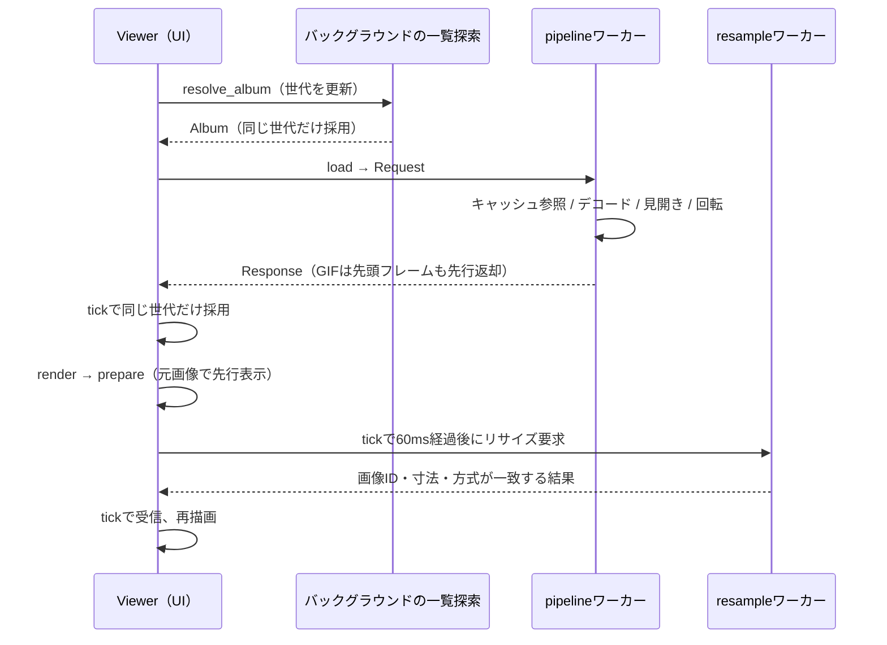

# コード構成と設計

開発を始めるときは [開発・検証](development.md)、操作と対応範囲は [README](../README.md) を参照する。この文書は現在の実装の責務と、変更時に維持する契約を説明する。

## モジュールの責務

通常バイナリは `src/main.rs` をルートとする。ライブラリクレートはなく、UI用の別ファイルも同じ `Viewer` に `impl Viewer` を追加する構成になっている。

| ファイル | 主な型・入口 | 責務 |
|---|---|---|
| [main.rs](../src/main.rs) | `Viewer`, `Command`, `main` | 起動、状態の所有、入力の振り分け、非同期結果の反映、描画、GPU画像の退役 |
| [i18n.rs](../src/i18n.rs) | `tr!`, 共有ローダー | Fluentの翻訳リソース、動的メッセージの引数、英語フォールバック |
| [model.rs](../src/model.rs) | `Album`, `Viewport`, `supported` | 画像一覧、並び替え、フォルダ探索、倍率・パン計算 |
| [decoder.rs](../src/decoder.rs) | `Decoded`, `decode_progressive`, `dimensions` | 形式判定、向き、GIF、libheif、表示画素への変換 |
| [pipeline.rs](../src/pipeline.rs) | `Loader`, `Request`, `Response`, `Loaded`, `worker` | デコード用ワーカー、世代管理、LRU、先読み、見開き合成・回転 |
| [resample.rs](../src/resample.rs) | `Algorithm`, `State` | 表示専用リサイズのワーカー、要求の集約、古い結果の破棄 |
| [settings.rs](../src/settings.rs) | `Settings`, `BoundaryAction`, `SortOrder` | 設定値、既定値、正規化、JSONの読み書き |
| [settings_ui.rs](../src/settings_ui.rs) | `Tab`, `Field`, `Selector` | 設定の下書き編集、候補一覧、キー割り当ての入力 |
| [bindings.rs](../src/bindings.rs) | `Shortcut`, `defaults` | 割り当て可能な操作と初期キー |
| [menu_ui.rs](../src/menu_ui.rs) | `Menu` | メニューバー、右クリックメニュー、メニュー内のキー操作 |
| [scrollbar.rs](../src/scrollbar.rs) | `settings_scrollbar` | 設定一覧のスクロールバーとドラッグ計算 |
| [viewer_io.rs](../src/viewer_io.rs) | `save_as`, `copy_image`, `show_information` | ファイル選択、書き出し、画像コピー、情報画面 |
| [ui_smoke.rs](../src/ui_smoke.rs) | `start` | `ui-smoke` feature専用の実ウィンドウ回帰テスト |
| [decode-bench.rs](../src/bin/decode-bench.rs) | `main` | GUIを起動せず、共有のdecoderでヘッダー取得とデコードを計測 |

## 開く操作から表示まで

`Viewer::new` は設定を読み、デコード用とリサイズ用のワーカーを用意する。約8msごとのtickerが `Viewer::tick` を呼び、結果の受信と自動送りを行う。UI状態は `Viewer` が所有し、ワーカーはGPUIのWindowを操作しない。

`open` はファイル／フォルダの指定を `resolve_album` へ渡す。ディレクトリ列挙とソートはバックグラウンドで行い、完了時に世代を照合する。採用した `Album` から `load` が現在ページ、回転、見開き候補、先読み候補を送る。空の一覧では画像を消し、進行中の要求を無効にする。

`pipeline::worker` は単一スレッドで、待っている要求を最新のものへまとめる。GIFの先頭フレームは、単独表示かつ追加回転なしの場合に先行返却する（`complete = false`）。最終結果は `complete = true`。Viewerはどちらも表示でき、世代が違う返却は捨てる。静止画像のデコード途中は中断しない。GIFはフレーム間で中止を確認する。

LRUは256 MiB・最大8エントリー。キーにはパス、更新日時、ファイルサイズ、回転、見開きの相手と表示条件を含む。現在画像の応答後に近隣画像を先読みし、新しい要求があれば止める。GIFの先読みは行わない。F5の `reload` は該当要求のキャッシュ参照を迂回する。

## 画像の表現と寿命

| 場所 | 画素と用途 |
|---|---|
| decoder内部の復号直後 | RGBA。EXIFまたはHEIFコンテナの向きを反映 |
| `Decoded.frames` / `Loaded.image` / `Viewer.image` | **BGRA**。元の解像度を保持し、見開き・追加回転の結果もここへ揃える |
| `resample::State` の処理済み画像 | BGRA。現在の表示サイズ専用 |
| `viewer_io::rgba_pixels` の出力 | RGBA。保存・外部コピー向けに赤と青を戻す |

`image::RgbaImage` / `Frame` という型名でも、表示経路では中身がBGRAの場合がある。色順は型名から判断せず、この境界を守る。保存・コピーには `Viewer.image` を使い、表示用リサイズの結果を使わない。

デコード画像は1辺16,384ピクセル・RGBA換算128 MiBを上限とし、GIFは全フレーム合計128 MiB・1,000フレームまで。幅か高さが0の画像は、見開き合成などの行単位の処理で扱えないため `decoder` でエラーにする。見開き合成が寸法または容量の上限を超える場合は1ページへ戻す。表示用リサイズは全フレーム合計128 MiB・1辺16,384ピクセルを超える要求でGPU表示へ戻る。元画像、作業バッファ、キャッシュ、GPUメモリは同時に存在し得るため、アプリ全体のピークメモリ上限ではない。

### 表示用リサイズ

`Viewer::render` は論理表示寸法に `window.scale_factor()` を掛け、実デバイスピクセルで目標寸法と拡大／縮小方式を決める。`State::prepare` は要求が変われば古い処理を無効化し、結果待ちには元画像を返す。`State::tick` は要求変更から60ms後にワーカーへ送る。結果は元画像の `ImageId`、幅・高さ、方式が現在の要求と一致する場合だけ採用する。

最近傍以外のCPU補間では、色とアルファを0〜1へ正規化し、アルファを乗算してから浮動小数点で補間する。補間後はアルファを除算し、色・アルファとも8bitへ戻す。`image` の浮動小数点補間へ0〜255を渡すと値が制限され、画像のアルファがほぼ失われる。回帰テスト `filtered_resize_preserves_opaque_and_translucent_colors` を維持する。ICC色管理やリニアライト補間には対応しない。方式とimage crateの対応は `Algorithm::filter` を参照する。GPUはGPUIのLinear、Nearestは最近傍、LinearはTriangle、CubicはCatmull-Rom、Lanczos3は同名のフィルターを使う。

### テクスチャの退役

`clear_image` とリサイズ画像の置換は、不要な `Arc<RenderImage>` を `Viewer.retired` へ移す。`render` では即 `window.drop_image` せず、`on_next_frame` を2回経た後で解放する。その時点で元画像または表示用画像として再利用中のIDは除外する。

これはGPUI 0.2.2のアトラスへの未処理アップロードと、以前のGPU送信の同期を通すため。描画中に即時解放すると、高速画像送りで `blade_atlas.rs:229` のパニックが再発し得る。`Arc` の解放だけでGPUの安全なタイミングを保証できるわけではない。検証には [実ウィンドウテスト](development.md#実ウィンドウの回帰テスト) を使う。

ウィンドウ終了時もX11のイベントループ再借用を避けるため、終了通知内の即 `cx.quit()` を避け、1ms後にウィンドウが残っていないことを確認して終了する。

## 閲覧状態と入力

`Album` はディレクトリ、並び替え済みのパス一覧、現在位置を保持する。対応拡張子は `supported`、数値順は整数への変換を避ける `natural_cmp` が担う。画像のある前後フォルダへの探索、空も含む同階層の隣接フォルダ、親フォルダは別の操作として実装されている。

`Viewport` はフィット、倍率、パンを保持し、`clamp` で画像が画面外へ消えないよう制限する。見開きの前進は `Loaded.pages` 枚単位で進み、後退は `decoder::dimensions` による直前画像の寸法も使う。横長単独設定、読む方向、左右キーの反転を混同しない。

キーボードは `Viewer::key` が設定画面、メニュー、情報画面の順で振り分け、その後に設定済み `Shortcut`、スクロール等を処理する。`shortcut_command` で `Command` へ変換し、ボタンやメニューも `command` へ集約する。

## 設定と外部出力

設定画面は `settings_draft` を編集する。セレクターの強調候補は別状態で、決定するまで下書きも変えない。`apply_settings` は正規化・保存が成功してから適用し、ソートと再読み込みを行う。失敗した場合は下書きを残してエラーを表示する。メニューの並び順やMの見開き切替もこの保存経路を使う。

`Settings` は `#[serde(default)]` により古いJSONの不足フィールドへ既定値を補う。読み込み時と保存時に `normalize` が数値等を制限する。壊れたJSONの自動上書きはせず、Viewerはエラーと既定値で起動する。JSONの保存は同じディレクトリの一時ファイルへ書き込み、sync後にrenameする。

画像保存も全エンコードを終えてから一時ファイルへ書き込み、sync・renameする。コーデック失敗時に既存ファイルを切り詰めない。GIFはフレームと時間を渡し、それ以外は先頭フレームを書き出す。元メタデータは引き継がない。

Linuxの画像コピーはBGRAをRGBAのPNGへ変換し、Waylandで `wl-copy`、X11で `xclip` に渡す。GPUI 0.2.2のLinuxクリップボード経路が外部へ画像形式を公開しないための補完。保存やコピーのエンコード・外部コマンド実行はバックグラウンドで行い、失敗はUIへ返す。

## 多言語対応

UI・アプリ自身のエラー・CLIヘルプはFluentの日本語・英語リソースへ集約している。初回はOS言語に合わせ、手動で保存した指定があればそれを優先する。共有ローダーはUIとワーカーから利用でき、翻訳は開発ビルドも含めてバイナリへ埋め込む。設定の保存値やUI要素IDは翻訳文言に依存させない。採用理由・検証の限界・追加手順は [多言語対応](localization.md) を参照する。

## ロゴ素材

採用ロゴは、横長の写真が重なるB2案。[assets/branding/logo.svg](../assets/branding/logo.svg) をカラー版の原本とする。主色は `#238B83`、補助色は `#8FC4BC` と `#B8D8CF`。

同じディレクトリに単色版（`logo-mono.svg`）、明るい単色版（`logo-light.svg`）、文字入り版（`logo-lockup.svg` / `logo-lockup-light.svg`）、32・64・256・512pxの透過PNGを置く。文字入り版の文字はパス化済みで、フォントのインストールを必要としない。SVGはベクターのみで構成し、背景の透明部分を白い塗りで埋めない。

PNGの生成・更新後は `just optimize-png` でoxipngによる可逆圧縮を行う。表示に影響しないメタデータだけを除去し、画素値は維持する。
